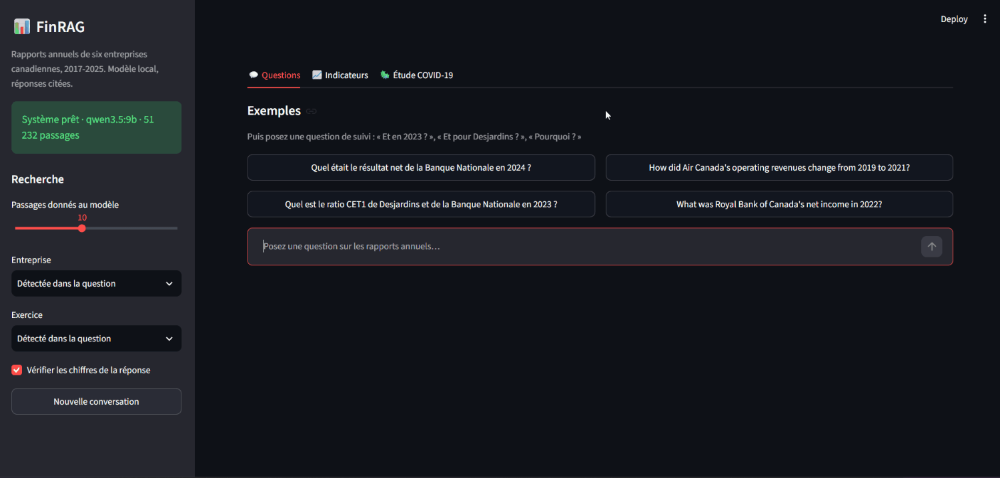
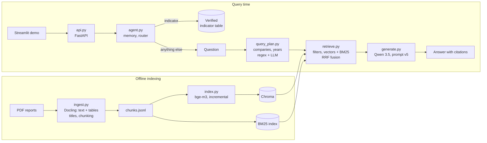

# FinRAG

**Question answering over nine years of Canadian annual reports, running entirely on a local GPU.**
Every answer cites its sources (document and page), and every design choice is backed by a
hand-verified evaluation set rather than by intuition.



> Status: phases A (baseline), B (table extraction), C (retrieval), D (verification, structured
> indicators, COVID-19 study) and E (API, demo, conversational agent, tests, Docker) complete.

## Highlights

- **54 annual reports**, 6 Canadian companies, fiscal years 2017 to 2025, in French and English
  (9,541 pages, 51,232 indexed passages).
- **Fully local**: Docling for layout and tables, `bge-m3` embeddings, Chroma and BM25, Qwen 3.5 9B served
  by Ollama on an 8 GB GPU. No document leaves the machine.
- **75-question reference set**, each answer verified by hand in the PDF, including 17 questions that have
  no answer in the corpus (hallucination traps).
- **Measured results**, from the first baseline to the current system:

| | Baseline (Qwen 2.5 7B) | **Current** |
|---|---|---|
| Accuracy | 53.4% | **86.2%** |
| Table questions | 38.1% | **85.7%** |
| Retrieval (right passage among those given) | 84.5% | **98.3%** |
| Precision when answering | 58.8% | **90.6%** |
| Confident errors | 19 | **3** |
| Traps answered (out of 17) | 1 | **0** |

- **A verified indicator table** (revenue, net income, diluted EPS, total assets, CET1): 225 values
  extracted by the same pipeline, each checked against its passage and cross-checked with the next year's
  report; 80% usable without review. It feeds a **study of the COVID-19 shock** across the six companies,
  whose causes are explained by the RAG with citations.
- **A conversational agent** behind a FastAPI service and a Streamlit demo: indicator questions are read
  from the verified table (exact, sourced, no LLM), everything else goes to the RAG; follow-up questions
  ("Et en 2023 ?", "Et pour Desjardins ?", "Pourquoi ?") take what they leave out from the previous turn.
  59 tests, a multi-turn benchmark, one `docker compose up` to run it.

## Corpus

| Company | Sector | Fiscal year end | Reports | Reporting currency |
|---|---|---|---|---|
| Air Canada | Airline | December 31 | 2017-2025 | CAD |
| National Bank of Canada | Bank | October 31 | 2017-2025 | CAD |
| CGI | IT services | September 30 | 2017-2025 | CAD (tables often in thousands) |
| Alimentation Couche-Tard | Convenience retail | End of April | 2017-2025 | USD |
| Desjardins Group | Cooperative financial group | December 31 | 2017-2025 | CAD |
| Shopify | E-commerce | December 31 | 2017-2025 | USD (thousands, then millions) |

The PDFs are not included in this repository (copyright). They can be downloaded from each company's
investor relations site or from [SEDAR+](https://www.sedarplus.ca), and must be named
`<company>_<fiscal-year>.pdf`, for example `banquenationale_2024.pdf`.

## Architecture



**Ingestion** (`ingest.py`)
- **Docling** (layout model and TableFormer, on the GPU, OCR off since the reports have a text layer)
  rebuilds every table row by row and returns the text in reading order, without page headers and footers.
- A page where Docling finds less than 70% of the text PyMuPDF finds keeps the PyMuPDF text (137 pages).
- Each window of 40 pages is cached: an interrupted run resumes where it stopped, and a crash in native
  code leaves a marker so that the next run skips those pages (80 pages, at the start of two Desjardins
  reports, fell back to PyMuPDF this way).
- **Table titles** come from the short lines just above the table: a numbered title ("Tableau 8 - ...")
  first, a period or unit line ("Pour les exercices terminés le 31 décembre") only as a complement, and
  never a running page header. Total rows without a label are labelled "Total".
- Large tables are split by rows; every part repeats the column header and the group rows it falls under
  ("Couvertures des flux de trésorerie > Risque de taux d'intérêt").
- Text chunks: 1,200 characters, 200 of overlap. Every chunk starts with a context header
  (`[Table | Company: ... | Fiscal year: ... | Page: ... | Title: ...]`).

**Indexing** (`index.py`): `bge-m3` (multilingual, 1,024 dimensions) in Chroma (cosine, HNSW). Only new or
changed chunks are embedded again. A BM25 index is built from the same chunks (`retrieve.py`).

**Query planning** (`query_plan.py`): the companies and fiscal years the question is about.
- **Regex** first: company names and aliases, years, periods ("de 2020 à 2024", "since 2021"), named
  reports ("selon le rapport annuel 2023"), several companies or "all companies".
- **LLM** only when the regex is not enough: no company found, an alias the regex does not trust alone
  ("la BN", "le Mouvement"), no year in digits ("l'an dernier", "les plus récents", "the pandemic", or no
  time at all: the LLM then returns no year), or a relative year ("the year after 2019"). It fills a JSON schema, and its answer is validated: a company must be
  designated in the question, years must be in the corpus.
- A question only about a company outside the corpus is declined **before any search**.

**Retrieval** (`retrieve.py`)
- **Filters** on company and fiscal year. Year Y searches the reports of Y and Y+1, which repeats Y as a
  comparative, unless the question names a report.
- **Hybrid search**: vectors and BM25, merged with Reciprocal Rank Fusion. For BM25, the question is
  translated into the language of the report when they differ, words of the filters are removed, and a
  passage must cover 30% of the question's information.
- **Periods and several companies**: one search per (company, year) pair, so that each is represented;
  above 7 pairs, the question is answered company by company, then the answers are combined.
- 10 passages per question.

**Generation** (`generate.py`): Qwen 3.5 9B, thinking off, temperature 0. Prompt v5: answer only from the
numbered sources, cite each fact, check the company and year of each source, answer the exact metric,
match terms across languages, answer in the language of the question. Extra rules for periods
(one figure per year, restated figures) and several companies (fiscal year ends, USD vs CAD).

## Evaluation

### Reference set

The set was built in two steps (`eval_questions.py`):

1. **Drafting**: passages were sampled at random from the corpus, independently of the retriever, across
   companies, years and passage types (35% tables). A local LLM drafted one question per passage, and
   drafts whose answer could not be traced back to the passage were rejected automatically.
2. **Manual verification**: each of the 74 drafts was checked against the PDF. About 40% were rejected
   or rewritten: wrong column, opening vs closing balance, unlabelled total rows, wrong unit, ambiguous
   questions. 17 questions without an answer were added, most of them entity-substitution traps
   (a competitor's net income, a banking ratio asked about an airline).

During phase C, `suspects.py` listed the questions where the model kept giving the same confident answer
across runs. Checked in the PDFs, 6 references were wrong or asked for more than the question (a
quarter's total revenue instead of one revenue line; a quarterly figure for an annual question; a sale
dated in the wrong fiscal year). The rule followed: **a question is fixed only when it is wrong or
ambiguous, never because it is hard**; rewording questions with the report's own words would have
measured a system that only works when users talk like the report.

| | Count |
|---|---|
| Questions with an answer | 58 (43 numeric, 15 qualitative; 21 from tables) |
| Questions without an answer | 17 |
| Language | 29 French, 29 English (often asked about a report in the other language) |

### Grading (`run_eval.py`)

Retrieval and generation are graded separately, so that each error can be traced to its source.

- **Retrieval** succeeds when one of the passages comes from the expected page (or an adjacent one),
  contains every expected figure, or, for qualitative questions, is confirmed by an LLM check.
- **Numeric answers** are graded by comparing figures, with French and English formats normalised
  (`8 608`, `8,608`, `2 836,3`, `2,836.3`), a 0.5% tolerance and detection of unit errors (x1,000).
- **Qualitative answers** are graded by an LLM judge (correct, partial or incorrect), thinking off.
- **Unanswerable questions** must be declined. **Language**: compared with the language of the question.

| Metric | Meaning |
|---|---|
| Accuracy | Share of answerable questions answered correctly |
| Precision when answering | Share of correct answers among the answers the system actually gave |
| Confident errors | Wrong answers given without any caveat: the most harmful error for financial analysis |
| Declined | Share of unanswerable questions correctly declined (the rest are hallucinations) |
| False refusals | Answerable questions the system declined |

Tools: `compare_runs` (all runs side by side), `diff_runs` (two runs question by question),
`show_errors` (where the expected figure was among the passages given), `suspects` (references to check),
`compare_tables` (table extraction methods), `bench_parser` (query planning, no answer generation),
`verify` (figures of the answers against their sources).

## Results

Qwen 3.5 9B, thinking off, judge Qwen 3.5 9B. Differences under about 5 points (3 questions) are not
conclusive on this set.

### Phase A: prompts and models

| Model | Prompt | Accuracy | Tables | Declined | Confident errors | Precision when answering | Language |
|---|---|---|---|---|---|---|---|
| qwen2.5:7b | v1 | 53.4% | 38.1% | 94.1% | 19 | 58.8% | 88.0% |
| qwen2.5:7b | v2 (+ entity, metric, table rules) | 51.7% | 28.6% | 100% | 19 | 58.0% | 86.7% |
| qwen2.5:7b | v3 (v2 without table rules) | 53.4% | 33.3% | 100% | 19 | 58.8% | 86.5% |
| qwen2.5:7b | v4 (v3 + language rule) | 48.3% | 28.6% | 100% | 19 | 54.0% | 95.9% |
| **qwen3.5:9b** | **v4** | **53.4%** | **38.1%** | **100%** | **7** | **75.7%** | **100%** |

### Phase B: table extraction

18 figures verified in the PDFs, searched for in the same clean row as their label (`compare_tables.py`):

| Method | Figure in a clean row | Merged cells | Seconds per page |
|---|---|---|---|
| Page text only | 0/18 | - | 0.03 |
| PyMuPDF `find_tables` (previous ingestion) | 3/18 | 791 | 0.43 |
| PyMuPDF, text strategy | 1/18 | 738 | 2.70 |
| PyMuPDF, lines + text | 7/18 | 615 | 0.48 |
| **Docling** | **18/18** | **0** | 6.55 on CPU, **1.30 on GPU without OCR** |

The whole corpus was converted in about one hour.

### Phase C: retrieval, series 1 (initial reference set)

| Run | Change | Accuracy | Tables | Retrieval | Declined | False refusals | Confident errors | Precision when answering |
|---|---|---|---|---|---|---|---|---|
| 1724 | Phase A best (PyMuPDF, vectors) | 53.4% | 38.1% | 84.5% | 100% | 21 | 7 | 75.7% |
| 0845 | + Docling | 53.4% | 57.1% | 77.6% | 100% | 23 | 4 | 80.0% |
| 0859 | + company/year filters from the evaluation set (upper bound) | 69.0% | 71.4% | 84.5% | 100% | 14 | 3 | 84.1% |
| 0926 | + filters detected in the question | 70.7% | 66.7% | 86.2% | 100% | 15 | 3 | 86.0% |
| 0954 | + hybrid search, first version | 62.1% | 61.9% | 81.0% | 94.1% | 16 | 4 | 78.6% |
| 1015 | hybrid search fixed (translation, coverage) | 72.4% | 57.1% | 94.8% | 100% | 6 | 10 | 78.8% |
| 1050 | + reranker (bge-reranker-v2-m3) | 72.4% | 61.9% | 91.4% | 100% | 6 | 8 | 76.9% |

### Phase C: retrieval, series 2 (corrected reference set)

| Run | Change | Accuracy | Tables | Retrieval | Declined | False refusals | Confident errors | Precision when answering |
|---|---|---|---|---|---|---|---|---|
| 1518 | 1015 + table titles | 79.3% | 76.2% | 94.8% | 94.1% | 6 | 6 | 84.6% |
| 1534 | + 10 passages instead of 6 | 84.5% | 85.7% | 96.6%* | 100% | 4 | 6 | 85.2% |
| 1629 | + prompt v5 | 86.2% | 85.7% | 96.6%* | 100% | 4 | 5 | 85.2% |
| 2112 | + hybrid query planning (regex + LLM) | 86.2% | 85.7% | 96.6%* | 100% | 4 | 5 | 85.2% |
| 2159 | + group rows in split tables, no running headers as titles | 84.5% | 85.7% | 96.6%* | 94.1% | 4 | 4 | 87.0% |
| **2245** | **+ next year's report, decline companies outside the corpus** | **86.2%** | **85.7%** | **98.3%*** | **100%** | 5 | **3** | **90.6%** |

\* With 10 passages; not comparable with the 6-passage runs.

### Query planning

`bench_parser.py`, 108 questions (50 written to test wordings, 58 from the reference set):

| Parser | Companies ok | missed | wrong | Years ok | wider | missed | wrong | Seconds per question |
|---|---|---|---|---|---|---|---|---|
| Regex | 104 | 2 | 2 | 90 | 0 | 13 | 5 | 0.00 |
| **Hybrid** | **108** | **0** | **0** | **103** | 1 | 1 | 3 | **1.00** |
| LLM only | 104 | 4 | 0 | 95 | 6 | 5 | 2 | 4.19 |

### Phase D1: verifying the cited figures

`verify.py` checks every figure of an answer against the passages the model was given, without an LLM.
The answer is split into sentences; each sentence keeps its citations ([S2]), or inherits those of the
previous one. Citations, dates, years, list numbers and page references are not figures; figures repeated
from the question are skipped. A figure matches in any format and scale of the reports (`1 476`, `1,476`,
`1 476,0`; thousands vs millions), within a rounding tolerance, and gets one status:

| Status | Meaning |
|---|---|
| supported | in a passage the sentence cites |
| computed | a difference, sum, growth rate or ratio of two figures of the passages |
| other_source | in another passage than the one cited (wrong citation) |
| unsupported | in no passage: invented or miscopied |

On the 53 answers of run 2245, graded by hand:

| Check | Figures | Answers flagged: correct / partial / incorrect |
|---|---|---|
| Deterministic | 122: 104 supported, 4 computed, 14 other source, **0 unsupported** | 0/48, 0/2, 0/3 |
| + LLM check of each sentence (`--llm`) | 72 sentences: 66 supported, 1 not found, 5 contradicted | 5/48, 0/2, 1/3 |

The answer model does not invent figures: every figure exists in the passages. Its errors are figures
**read in the wrong place** (another row, column or year), which the deterministic check cannot see. The
LLM check, which could, flagged 5 correct answers for 1 incorrect one out of 3: a 9B model cannot reliably
judge its own reading. The verifier is available in `generate.py` (`FINRAG_VERIFY=flag` adds a warning,
`revise` asks for one correction) and off by default.

### Phase D2: a verified indicator table

`kpis.py` extracts, for each company and fiscal year 2017-2025, revenue, net income, diluted EPS, total
assets and the CET1 ratio (banks), in millions of the reporting currency. The LLM extracts the value in
JSON from retrieved passages; everything after that is deterministic:

1. **Search**: the indicator words, then the statement name, then the comparative column of the next
   year's report.
2. **The figure must be written as such in the cited passage**: a rounded figure of the text ("1,7 G$" for
   1 673,2) is rejected.
3. **The row label must name the indicator** and none of the look-alike lines: income before taxes taken
   for revenue, comprehensive income, adjusted measures.
4. **A full fiscal year of the whole company**: quarters (CGI's "trois mois", Couche-Tard's 12- and 16-week
   periods) and business segments (the table title names one) are rejected.
5. **Sign and unit read from the passage**: the LLM drops the parentheses of a loss and reads CGI's
   thousands as millions.
6. **Cross-check** with the next report and **series checks**: a value 1,000 times off its neighbours is
   rescaled, an outlier is sent to review.
7. **Hand-verified values** (`eval/kpi_gold.jsonl`, 50 values) replace the extraction; the extracted value is
   kept, so that the extraction is scored against them.

| Confidence | Values | Meaning |
|---|---|---|
| manual | 50 | verified by hand in the PDF |
| high | 109 | verified in its passage and confirmed by the next report |
| medium | 21 | verified, no next report to compare (mostly 2025) |
| review | 18 | the two reports disagree, or an outlier in the series |
| low | 27 | not verified or not found |

Errors each layer caught, among others: Couche-Tard's quarters taken for its fiscal year; CGI's tables in
thousands read as millions; National Bank's 2019 net income with a wrong sign; Desjardins's surplus read
after member dividends (2 366 for 2 598), then from a business segment (1 314 for 2 419), and the line
check that had excluded the right line ("Excédents **avant** ristournes" was rejected as "before taxes").

### Phase D3: the COVID-19 shock

`covid.py` compares each company's **COVID fiscal year** with fiscal 2019. Fiscal years do not cover the
same months: fiscal 2020 has about 10 months of pandemic at a December year end, 8 at National Bank, 7 at
CGI, and only 6 weeks at Couche-Tard (year ending April 26, 2020), whose COVID year is therefore 2021.
Figures come from the indicator table (manual or high confidence for every value used); in millions of the
reporting currency, net income including non-controlling interests.

| Company | COVID year | Revenue | Net income | Net margin 2019 -> COVID year | Revenue back to 2019 level |
|---|---|---|---|---|---|
| Air Canada | 2020 | -69.5% | 1 476 -> -4 647 | 7.7% -> -79.7% | 2023 |
| National Bank | 2020 | +6.7% | -10.3% | 31.2% -> 26.3% | no decline |
| CGI | 2020 | +0.4% | -11.5% | 10.4% -> 9.2% | no decline |
| Couche-Tard (USD) | 2021 | -22.6% | **+48.5%** | 3.1% -> 5.9% | 2022 |
| Desjardins | 2020 | +3.4% | -6.9% | 12.5% -> 11.3% | no decline |
| Shopify (USD) | 2020 | +85.6% | loss -> profit | -7.9% -> 10.9% | no decline |

Four profiles: a collapse (Air Canada, the only business that stopped); stable revenue but lower profit,
from credit loss provisions (National Bank 347 -> 846 M$, Desjardins 365 -> 863 M$) or restructuring (CGI,
155 M$); lower revenue but higher profit (Couche-Tard: its revenue follows the price of fuel, while its fuel
margin rose); and an acceleration (Shopify, e-commerce).

The causes come from the RAG (`--explain`), two questions per company, each answer checked by the verifier:

- **"What was the impact of COVID-19 on ... in fiscal 2020?"** finds the passages that name the pandemic:
  travel restrictions, provisions, risk factors. It missed Couche-Tard's fuel margin and CGI's
  restructuring, which the reports explain without the word COVID, and mixed realised and potential effects.
- **A question built from the table** ("Why did net income go from 2 357.6 to 2 705.5 M$ US while revenue
  fell 15.5%?") finds the analysis of results instead: Couche-Tard's fuel margin, National Bank's provisions
  and special items (36 + 52 + 35 + 10 = 133 M$, all correct). For Desjardins, whose table then held the
  surplus after member dividends, the model answered that the figures of the question were not in its
  sources: the RAG caught an error of the indicator table.

### Phase E: API, demo and conversational agent

**API** (`api.py`, FastAPI): `/ask` (one question, RAG, figure check), `/chat` (one turn of a conversation,
with a session), `/kpis` (the indicator table, filtered by company, indicator, year and confidence), `/covid`,
`/health` (Ollama, models, indexed passages). The GPU serves one question at a time (a lock); table reads
answer at once. Errors are explicit: 422 for an unknown company or year, 503 when Ollama is down.

**Demo** (`app.py`, Streamlit): a chat that shows, under each answer, the route taken, what was taken from
the previous question, the question as understood, the figure check and the sources; the indicator table
with charts; the COVID-19 study.

**Agent** (`agent.py`):
- **Router.** A question about one indicator of the table, for given companies and years, is answered from
  the table when every value is verified (manual, high or medium confidence): exact, with its source and
  page, in milliseconds, with a warning when a series crosses Desjardins's change of accounting standard.
  Explanations, rankings, other measures (net interest income, a quarter, a segment, adjusted figures,
  one kind of revenue) and values still to review go to the RAG. The indicator is found with patterns: a
  missed wording only sends the question to the RAG, as before.
- **Memory.** A question that names no company and no other name ("Et en 2023 ?", "2023?", "Pourquoi ?") is
  planned with the previous turn's companies written in, so that its years are read as for a full question
  ("Et ses revenus les plus récents ?" -> 2025). The indicator carries over to a short follow-up and to a
  question about it, not to another question about the same company ("Qui est le PDG ?"). A name outside
  the corpus is never completed from memory.
- **For the RAG**, a follow-up is rewritten as a standalone question from the previous questions only (not
  the answers); a bare "Pourquoi ?" after a value becomes the question that worked best in D3 ("why did it
  change from the year before?"); the words of the reports are added when they differ from the usual ones
  (Desjardins's "excédents avant ristournes aux membres", CGI's "bénéfice net").
- **Cross-check.** When the RAG answers a value the table holds, even one still to review, the two are
  compared, and a difference is shown: one of them is wrong.

Multi-turn benchmark (`bench_agent.py`): for each turn, the companies, years and indicator understood after
the memory, and the route; the real query planner, no answers.

| Version | Turns fully right | Conversations fully right |
|---|---|---|
| First version | 13/30 | 1/10 |
| + follow-ups planned with the previous companies written in | 27/30 | 8/10 |
| + no year without a time expression (planner prompt) | **30/30** | **10/10** |

The conversations were written with the agent, so this measures what it was designed to do; conversations
written by someone else are the next test. 59 unit tests (`pytest`) cover the API, the router, the memory
and the answers from the table, without Ollama.

### Findings

1. **The context window was not the problem.** Phase A runs with and without `num_ctx` give the same scores.
2. **Checking the company in each source removes hallucinations** (prompt v2 onwards), but this protection
   is fragile, see 10.
3. **Some prompt rules hurt.** Table-reading rules lowered table accuracy from 38.1% to 28.6% with Qwen 2.5:
   prompt rules have to be measured one by one.
4. **Qwen 3.5 is more reliable, not more accurate.** Same accuracy as the best Qwen 2.5 run, but most errors
   become explicit refusals: confident errors fall from 19 to 7.
5. **Docling fixed table extraction, but accuracy did not move until retrieval was fixed.** Tables went from
   38% to 57%, overall accuracy stayed at 53.4%: the search returned the right page of the wrong year.
   Annual reports repeat the same paragraphs every year, and neither embeddings nor keywords can tell those
   copies apart. Filtering on the company and year asked raised accuracy by 17 points, and the filters
   detected in the question did as well as the ones taken from the evaluation set.
6. **Hybrid search needs to handle languages.** The first version collapsed Couche-Tard (9% accuracy): its
   reports are in French and many questions in English, so BM25 matched only the company name and its noise
   was ranked as high as the good vector results by the fusion. Removing the filter words, translating the
   question for BM25 and requiring a minimum coverage raised retrieval from 86% to 95%.
7. **The reranker brought nothing measurable** for 2.3 GB of model and extra time: disabled.
8. **Once retrieval worked, reading became the bottleneck.** Two fixes on the ingestion side helped most:
   table titles (period lines like "Pour les exercices terminés le 31 décembre" had been taken as titles,
   so the table matched no question) and 10 passages instead of 6 (table accuracy 76% -> 86%).
9. **A year's figures are also in the next report.** Searching the reports of Y and Y+1 raised retrieval to
   98.3% and cut confident errors to 3.
10. **Do not let the answer model reject look-alike entities.** Asked for Royal Bank of Canada's net income,
    the search, without any filter, returned National Bank of Canada's 2022 results, and the model gave
    them. The query plan now recognises a company outside the corpus and declines before any search.
11. **Regex for precision, LLM for coverage.** Regex never chose a wrong company on clear names, but missed
    "la BN", "l'an dernier" or "the pandemic years". The LLM alone understood more but widened years and
    was 5 times slower. The hybrid parser keeps the regex result and asks the LLM only what is missing.
12. **The model does not invent figures, it misreads them.** None of the 122 figures of the answers was
    absent from the sources; the errors were figures of another row, column or period. Checking that a
    figure exists is cheap and deterministic; checking that it was read in the right place needs
    understanding, and a 9B model judging its own answers is not reliable enough for it.
13. **For a table of figures, an LLM extracts and code verifies.** The LLM is good at finding a value in a
    passage and bad at its sign, unit, period and exact line. Each deterministic check, the cross-check
    with the next report and a few hand-verified values caught a different class of error.
14. **Each rule needs a test on the real labels.** Excluding "avant" to reject "income before taxes" also
    rejected Desjardins's net income ("Excédents avant ristournes"); the segment tables of Desjardins reuse
    the consolidated labels. Both were found by the hand-verified values, not by the rules themselves.
15. **Structured data makes the RAG better at explaining.** Asked generally about COVID-19, the model
    summarised what the reports say about the pandemic; asked why a figure of the table moved, it found the
    analysis of results and explained the change. The table guides the search; the model only explains.
16. **A list of wordings breaks where it decides; it is safe where it only opens a shortcut.** The query
    planner called the LLM on a list of time words: "récent" was there, "récents" was not, and "les revenus
    les plus récents" searched nine years at once. Calling the LLM for every question without a year fixed
    it for 0.2 s. The router's patterns are kept: a missed wording sends the question to the RAG, as before.
17. **Two safe rules can make a wrong one together.** Declining companies outside the corpus (finding 10)
    and asking the LLM about questions without a year turned every "Et en 2023 ?" into a question about an
    unknown company: the memory never applied (1 conversation right out of 10). The benchmark showed it
    at once; a follow-up is now planned with the previous companies written in.
18. **The same figure read twice is a better check than a figure found once.** The verifier accepts any
    figure that exists in the sources, so Desjardins's total revenue given as its net income passed. The
    table and the RAG are independent: when they disagree, one of them is wrong, and the user is told.
19. **A conversation propagates errors.** A rewritten follow-up that took a figure from the previous answer
    ("Why was net income 14,660 M$?") turned a wrong answer into a wrong question. The rewriting now sees
    the previous questions only.

### Limitations

- 58 answerable questions: per-company scores (6 to 12 questions) are indications, not conclusions.
- **The reference set has no question about a period, several companies, or a paraphrased company or date.**
  The query planner handles them (`bench_parser`), but their answers are not evaluated yet.
- The figure grader checks that the expected figures appear in the answer, not the role they play in it.
- The LLM judge's agreement with human grading has not been measured.
- 80 pages (the first 40 pages of the Desjardins 2018 and 2020 reports) are extracted with PyMuPDF,
  Docling crashing on them.
- The verifier checks that a figure exists in the sources, not that it was read from the right row,
  column or period.
- 45 values of the indicator table (`kpis_review.csv`) still need a check by hand.
- Desjardins applies IFRS 17 (insurance contracts) since 2023, with 2022 restated: insurance revenue is
  presented net of claims, so its revenue halves between 2021 and 2022 without any change in activity.
  Its series are comparable within 2017-2021 and within 2022-2025 only; the agent says so for a table
  answer, the RAG does not.
- The agent never asks for a clarification: an ambiguous question ("le résultat", a company with several
  reporting entities) is answered with its most likely reading.
- The COVID explanations are graded by hand on 12 answers; the Air Canada analysis, with large tables, is
  confused.

## Setup

Requirements: Python 3.10+, [Ollama](https://ollama.com), an NVIDIA GPU with 8 GB of VRAM recommended,
PyTorch with CUDA for Docling.

```bash
ollama pull bge-m3
ollama pull qwen3.5:9b

python -m venv .venv
source .venv/bin/activate     # Windows: .venv\Scripts\Activate.ps1
pip install -e .
pip install docling           # then PyTorch with CUDA, e.g. --index-url https://download.pytorch.org/whl/cu126
```

Put the PDFs in `data/raw/`, then:

```bash
python -m finrag.ingest              # PDFs -> data/processed/chunks.jsonl (Docling, about one hour on GPU)
python -m finrag.index               # chunks -> Chroma (only changed chunks)
python -m finrag.ask "Quel était le résultat net de la Banque Nationale en 2024 ?"
```

Evaluation:

```bash
python -m finrag.run_eval --filters auto -k 10   # run and grade -> eval/results/
python -m finrag.compare_runs                    # compare all runs
python -m finrag.bench_parser                    # query planning only
python -m finrag.verify eval/results/<run>.jsonl # figures of the answers against their sources
```

API, demo and agent:

```bash
python -m finrag.api                     # http://localhost:8000/docs
streamlit run src/finrag/app.py          # http://localhost:8501 (needs the API)
python -m finrag.agent                   # the agent in the terminal
python -m finrag.bench_agent             # multi-turn benchmark
pytest tests                             # unit tests, no Ollama needed
```

With Docker (the index and the indicator table are built beforehand and mounted from `./data`; Ollama
runs on the host, listening on all interfaces: `OLLAMA_HOST=0.0.0.0`):

```bash
docker compose up --build                # demo on http://localhost:8501, API on http://localhost:8000/docs
docker compose --profile ollama up       # or with Ollama in a container (set FINRAG_OLLAMA_HOST=http://ollama:11434)
```

Indicators and the COVID-19 study:

```bash
python -m finrag.kpis --crosscheck              # extract and cross-check -> data/processed/kpis.csv (about 1 hour)
python -m finrag.kpis --finalize                # re-apply checks and eval/kpi_gold.jsonl, no LLM
python -m finrag.covid --explain                # table, charts and explanations -> data/processed/covid_study.html
```

Settings (environment variables or `run_eval` options):

| Variable | Option | Default | Meaning |
|---|---|---|---|
| `FINRAG_LLM_MODEL` | `--model` | `qwen3.5:9b` | Generation model |
| `FINRAG_PROMPT` | `--prompt` | `v5` | System prompt version |
| `FINRAG_THINK` | `--think` | `off` | Reasoning mode |
| `FINRAG_NUM_CTX` | `--num-ctx` | `8192` | Ollama context window |
| | `-k` | `10` | Passages per question |
| `FINRAG_EXTRACTOR` | (`ingest --extractor`) | `docling` | `docling` or `pymupdf` |
| `FINRAG_RETRIEVAL` | `--retrieval` | `hybrid` | `vector`, `bm25` or `hybrid` |
| `FINRAG_TRANSLATE` | | `on` | Translate the question for BM25 when the report is in the other language |
| `FINRAG_RERANK` | `--rerank` | `off` | Cross-encoder reranker |
| `FINRAG_AUTO_FILTERS` | `--filters` | `on` (`none` in `run_eval`) | Company and year filters from the question |
| `FINRAG_QUERY_PARSER` | `--parser` | `hybrid` | `regex`, `llm` or `hybrid` |
| `FINRAG_YEAR_WINDOW` | `--year-window` | `1` | Also search the next year's report |
| `FINRAG_PERIOD_YEAR_WINDOW` | | `1` | Same, for each year of a period question |
| `FINRAG_MAX_SLOTS` | | `7` | Above this many (company, year) pairs, answer company by company |
| `FINRAG_VERIFY` | `--verify` | `off` | `flag` or `revise`: check the figures of each answer |

## Project structure

```
finrag/
├── src/finrag/
│   ├── config.py          # paths and settings
│   ├── ingest.py          # Docling (or PyMuPDF) -> chunks, table titles
│   ├── index.py           # embeddings -> Chroma, incremental
│   ├── query_filters.py   # regex: companies, years, periods
│   ├── query_plan.py      # search plan: regex + validated LLM
│   ├── retrieve.py        # filters, vectors + BM25, fusion, translation, reranker, per-slot search
│   ├── generate.py        # prompts, cited answers, decomposition by company
│   ├── ask.py             # command-line interface
│   ├── eval_questions.py  # build the reference set
│   ├── run_eval.py        # run and grade the evaluation
│   ├── compare_runs.py    # all runs side by side
│   ├── diff_runs.py       # two runs question by question
│   ├── show_errors.py     # where the expected figure was
│   ├── suspects.py        # references to check
│   ├── compare_tables.py  # table extraction benchmark
│   ├── bench_parser.py    # query planning benchmark
│   ├── add_questions.py   # add completed draft questions to the reference set
│   ├── verify.py          # D1: figures of an answer against its sources
│   ├── kpis.py            # D2: indicator table, checks, cross-check, hand-verified values
│   ├── covid.py           # D3: COVID-19 study, report and explanations
│   ├── agent.py           # E: router (indicator table or RAG), conversation memory
│   ├── api.py             # E: FastAPI service
│   ├── app.py             # E: Streamlit demo
│   └── bench_agent.py     # E: multi-turn benchmark
├── tests/                 # pytest: API and agent, without Ollama
├── eval/
│   ├── questions.jsonl    # reference set
│   ├── table_cases.json   # verified table figures
│   ├── parser_cases.jsonl # wordings for the query planner
│   ├── kpi_gold.jsonl     # hand-verified indicator values
│   ├── conversations.jsonl # multi-turn benchmark
│   └── results/           # one .jsonl and one .summary.json per run
├── data/                  # PDFs, Docling cache, chunks and indexes (not versioned)
├── Dockerfile             # API + demo image (serving only)
├── docker-compose.yml     # api, ui, and optionally ollama on the GPU
└── requirements-serve.txt # serving dependencies
```

## Roadmap

- [x] Phase A: baseline, evaluation set, grader, prompt ablation, model comparison
- [x] Phase B: table extraction (Docling), table titles and group rows in chunk headers
- [x] Phase C: company and year detection, hybrid BM25 + vectors, query translation, reranker (evaluated,
      off), query planning with an LLM, periods and several companies
- [ ] Evaluation set: questions about periods, several companies and paraphrases, scored by category
- [x] Phase D: verifier of cited figures; verified indicator table; COVID-19 study across the six
      companies, explained by the RAG
- [x] Phase E: FastAPI service, Streamlit demo, Docker, tests; conversational agent (router to the
      verified indicator table, memory of follow-up questions, multi-turn benchmark)
- [ ] Agent: ask for a clarification when a question is ambiguous; conversations written by other users
      in the benchmark; warnings for comparisons across an accounting change in RAG answers
- [ ] Incremental ingestion orchestrated with Airflow

## Models and licenses

| Model | Role | License |
|---|---|---|
| Docling models (IBM: layout, TableFormer) | Document conversion | MIT (Docling); see the model cards |
| bge-m3 (BAAI) | Embeddings | MIT |
| bge-reranker-v2-m3 (BAAI) | Reranker (evaluated, off by default) | Apache 2.0 |
| Qwen 2.5 7B (Alibaba) | Generation (phase A baseline) | Apache 2.0 |
| Qwen 3.5 9B (Alibaba) | Generation, query planning, evaluation judge | See the model card |

## Author

Mahamed Al-Amine Manou Amadou, M.Sc. in Computer Science (Artificial Intelligence), Université Laval.
[LinkedIn](https://www.linkedin.com/in/mahamed-al-amine-manou-amadou-97988b294)
